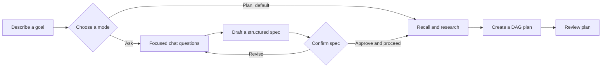
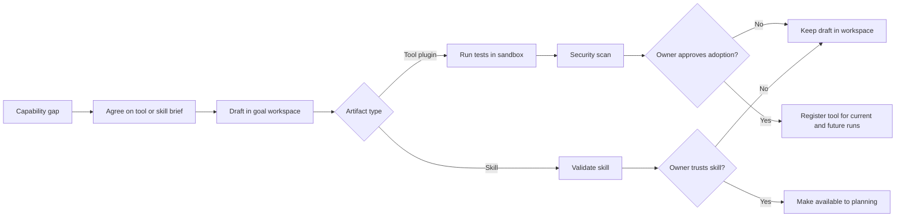
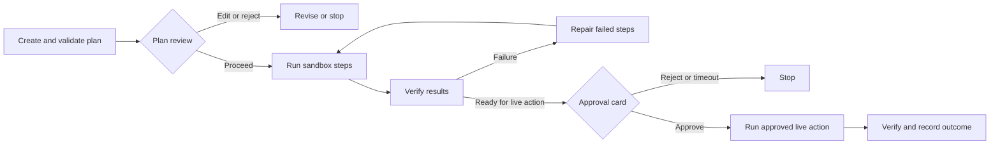
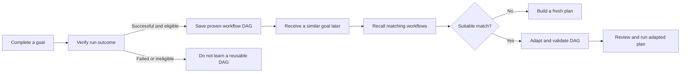

# Aidon's four showcase features

Aidon turns a natural-language goal into checked work through a reusable,
human-reviewed workflow. Plan mode is the default in interactive conversations;
Ask mode is available when the user wants a guided interview before planning.

## 1. Natural-language goals and guided interviews

Users describe the result they want in ordinary language. Plan mode uses that
goal to prepare a reviewable plan. In Ask mode, Aidon asks focused questions,
records the answers in a structured spec, and asks the user to confirm it
before moving to Plan mode.

**Implemented in:** `src/agentic/interview.py`, `src/agentic/spec.py`,
`src/interface/webui_runs.py`, and `src/interface/webui_messaging.py`.

## 2. Tool and skill creation

When the requested work needs a missing capability, Aidon can draft a tool
plugin or skill in the goal workspace. Tool plugins are tested in an isolated
environment and scanned before adoption; adopting one requires owner approval.
Skills go through candidate, validated, and trusted states. Only trusted skills
are supplied as trusted planning context.

**Implemented in:** `src/capabilities/plugin_acceptance.py`,
`src/capabilities/plugins.py`, `src/capabilities/skill_library.py`,
`src/capabilities/skill_lifecycle.py`, and `src/interface/webui_labs.py`.

## 3. Human review and approval

Plan mode pauses with a plan for review before executing its steps. Work that
requires a consequential live action is presented for explicit approval. A
rejected or timed-out decision stops the action. Tool adoption and other
privileged operations have their own approval requirements.

**Implemented in:** `src/interface/approval.py`, `src/agentic/plan_run.py`,
`src/agentic/run_finalization.py`, and the live-action modules under
`src/capabilities/`.

## 4. Learning and reusable DAG workflows

After a successful run, Aidon can save its proven steps as a reusable DAG.
Later, it searches for workflows with a similar goal and can adapt a saved DAG
to the new request. The adapted workflow is validated before it is used, so a
failed or unsuitable match falls back to a fresh plan.

**Implemented in:** `src/agentic/run_finalization.py`,
`src/agentic/loop.py`, `src/agentic/dag.py`, and
`src/memory/experience.py`.

These features share the same goal runner and approval boundaries; messaging
channels change how a request and its decisions arrive, not the underlying
workflow.
