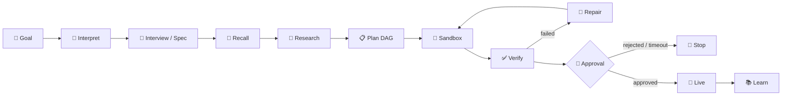
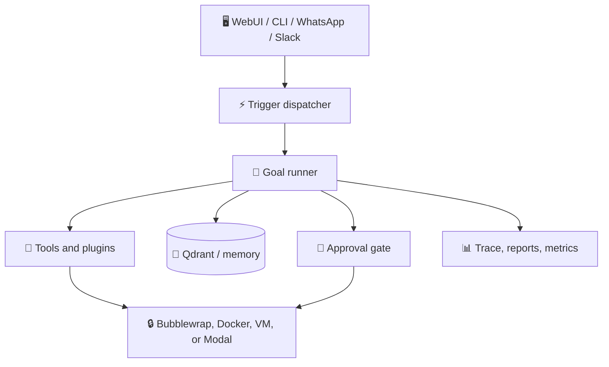

# 🏗️ Architecture

Aidon is an autonomous agent: the user gives only a goal,
in plain language, and Aidon researches, plans, tests in
a sandbox, verifies, asks approval, executes live on
approval, and learns from the run, so the next similar
goal starts from what actually worked.

## 🔁 Run order

1. Interpret: a chat message, an attached spec sheet,
   a trigger event, or a v1 or MCP goal submission.
2. Interview: chat questions, no clock, no cards, to a
   frozen spec, or a user-written spec sheet attached
   in chat, which skips the interview. Spec approval
   is a decision card, with a spec sheet as its body.
3. Recall: previous Experiences, episodic memory, and
   research sources for a similar goal, before planning
   fresh.
4. Research: facts verified only if a fetched source
   excerpt contains them, with source, date, and excerpt
   recorded. Unverified claims stay unverified.
5. Plan: steps, deliverables, and criteria, as JSON,
   from the model, bound by the frozen spec.
6. Sandbox: steps run with sandbox tools, or with
   adopted plugin tools, in a bubblewrap sandbox, a
   Docker container, or on a VM over SSH, chosen by
   the owner, never by the model.
7. Verify: deliverables must exist and be non-empty,
   criteria are checked by code, ledger totals are
   recomputed by code. An optional model second opinion
   (AIDON_MODEL_VERIFIER, off by default) judges content
   only after code passes, and never overrides code.
8. Repair: only failed steps are repaired, passed
   files are untouched, at most 3 attempts in total.
9. Approval: a decision card, fail-closed on timeout,
   before any live action.
10. Live: only a closed list of live actions, copy a
    verified file to a spec-named output with a
    snapshot backup, and record a notification.
    Live verification checks outputs exist and are
    non-empty, rollback restores snapshots on failure.
11. Learn: episodic memory, Experience, research report,
    and live record, with promotion to long-term memory
    that is automatic, deduplicated when identical and
    superseding when the same shape recurs.

## 🧩 Components

- Model client: endpoint, key, and model name only,
  OpenAI-compatible chat completions, stdlib urllib,
  FakeClient for tests. No model vendor is hardcoded
  into the run logic.
- Presentation: the WebUI and conversational CLI share the same
  model/configuration path. WebUI TTS can stream Fish Audio chunks,
  while the final response footer reports elapsed time and token usage.
  These are presentation features, not a separate execution backend.
- Memory: Qdrant for all collections, working,
  episodic, semantic, experience, and knowledge, with
  hybrid dense plus sparse recall, forgetting curve,
  grace, and explicit prune. Library files live in
  the Aidon home, never in the repo, never in a
  central service.
- Tools: sandbox tools are arena plumbing, write,
  read, list, shell, and calculate, all confined to
  the workdir. Capability tools are plugins, adopted
  after a security scan and an owner decision card.
- Triggers: scheduler, WhatsApp, Slack, WebUI,
  ingest folder, webhook, and manual, all as
  TriggerEvents that start a goal run, never bypassing
  approval, spec, or verification. No Telegram source.
- Execution: bubblewrap backend, Docker backend,
  subprocess backend, VM backend over SSH to a VM
  you already run, and Modal backend running commands
  in Modal cloud sandboxes. Setup does not provision a VM;
  disposable VM per run is post-hackathon. Docker is
  disposable, workdir only mounted, non-root, all
  capabilities dropped, network off by default,
  resource limits, pinned image, no docker.sock,
  no host credentials, fail closed if Docker is missing.
- Capability hub and acquisition governor: the hub
  indexes every capability with lifecycle, health,
  availability, and verification, and triage reads it;
  ordinary skill recall is trusted-only. A per-run
  governor caps tools, skills, MCP servers, dependency
  sets, repair cycles, and acquisition seconds, with
  budgets that survive stops.
- Clef router: when `AIDON_ROUTER=clef` and
  `AIDON_CLEF_URL` is set, a decision model ranks intent
  and DAG candidates; an empty URL means no Clef
  anywhere.
- Diagnostics: rotating log, error records, and
  `aidon diagnostics <run_id>` reports. Diagnostics
  record only and never steer planning.
- Budgets and trace: token, step, and time budgets,
  enforced, with estimated tokens labeled as estimates.
  Trace events, one per stage, in run order, with no
  secrets, no tokens, and no file content values,
  written to trace files in the Aidon home.
- v1 API and MCP: external stable API at /api/v1/*,
  separate from internal WebUI /api/*, with Bearer
  token auth, owner and agent scopes, key generation
  with hash only stored in a 0600 file, and an MCP
  server wrapping the same v1 store, with tools
  filtered by scope. Agent scope cannot approve and
  cannot manage keys, in v1 or in MCP.

## 💾 Storage, in the Aidon home, never in the repo

- specs: spec JSON and Markdown sheet, per chat.
- plugins: adopted plugin directories, per name.
- skills: standalone Markdown skills, per name.
- library: library files, per item id.
- knowledge: knowledge files and manifest.
- qdrant: Qdrant collections, local mode or server.
- learned: last run record, with research and live.
- trace: trace files, per run id.
- v1: key hashes and goal records, keys in 0600 file.
- live: live outputs snapshots and notifications.
- ingest: user files dropped for ingestion, by the user.

## 🛡️ Security boundaries

- Approval is for decisions, chat is for conversation.
  Questions have no clock and no card, decisions have
  a fail-closed clock.
- Secrets never in chat, never in a trace, never in a
  scan report, never in a key list, only as a hash.
- A plugin scan reports path, line, and type only,
  never values, and never an invented CVE id.
- A trigger starts work, it never approves work.
- A live action is a closed list, never an arbitrary shell.
- A budget exceeded fails a run, it does not continue it.
- A Docker container mounts only the workdir, never
  docker.sock, never host credentials, never a host home.

## 🗂️ Layout, grouped, not flat

Code lives in `src/`, grouped by what it does, so a reader can find a system without reading 70 files in one directory. `src/system/main.py` is the entry point, it imports from the groups, it does not contain the systems itself. `src/` itself contains only `__init__.py` and the group directories, no modules at the top level.

- `src/system/` — config, model client, and `main.py`, the entry point. The model client is endpoint, key, and model name only, OpenAI-compatible, stdlib, FakeClient for tests.
- `src/memory/` — Qdrant memory, embedder, entity graph, KB parsing, Experience, redaction, rolling summary, library links.
- `src/agentic/` — goal loop, DAG and DAG store, adapt, swarm, interview and spec, validation, model verifier, budgets, trace, counting, metrics, benchmark, kernel, routers, research.
- `src/interface/` — WebUI and robot avatar, messaging, v1 API, MCP server and client, triggers, scheduler loop, run control, approval and pre-approval gates.
- `src/capabilities/` — sandbox and execution backends, tools and plugins, skill lifecycle, live actions, search, voice, GitHub, email and Gmail, image generation and editing, charts, Unity assets, Playwright MCP, SAM segmentation, video pipeline.
- `src/social/` — one-way social publishing, Threads and Instagram, plus YouTube search, metadata, and transcripts.

Old flat layout, `src/*.py` with no sub-directory, is superseded by this grouped layout. Tests import from the grouped paths, for example `from src.memory.memory import Memory`, not `from src.memory import Memory`.
